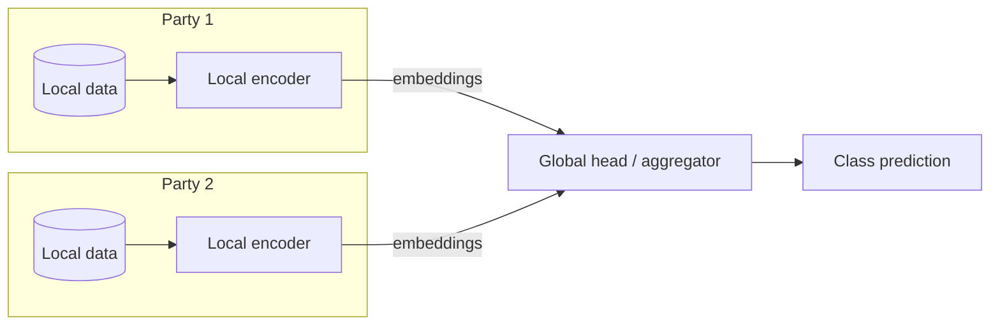

# Simple-VFL

[](https://github.com/xavierxav/Simple-VFL/actions/workflows/ci.yml)

[](LICENSE)

A compact PyTorch implementation of **Vertical Federated Learning (VFL)**. Each party holds a different view of the same samples, trains a local encoder, and only the resulting embeddings are shared with a global head. The repository covers several SplitNN variants, satellite and tabular datasets, DINOv2 feature extraction, Hydra configuration, TensorBoard logging, early stopping, tests, and CI.

The code is adapted and simplified from [VFLAIR](https://github.com/FLAIR-THU/VFLAIR).

## What is original here

The SplitNN training skeleton follows VFLAIR (see [ATTRIBUTION.md](ATTRIBUTION.md)). The parts
specific to this repository are:

- a DINOv2 ViT-g/14 feature pipeline for WorldStrat (SPOT + Sentinel L2A) and VertiBench, with the
  extracted features published on [Hugging Face](https://huggingface.co/datasets/xavvierxav/L1C_dataset);
- a comparison protocol across vertical, horizontal, isolated-party and late-aggregation settings,
  on identical POI-grouped splits, with per-class metrics;
- the Hydra layer: one config tree, multi-seed sweeps, readable output folders, early stopping and
  TensorBoard logging;
- a deliberately small core (~1,200 lines) that keeps the SplitNN semantics and drops VFLAIR's
  communication, attack and defence stack, plus tests, CI and a `pip install` package.

## Highlights

- Clear separation between local party models and the global aggregation head.
- Models for vertical, horizontal, isolated-party, and aggregation settings.
- Credit-card tabular data and WorldStrat/SPOT/Sentinel/VertiBench satellite data.
- DINOv2 feature extraction scripts for satellite imagery.
- Hydra configs, multi-run sweeps, TensorBoard logs, and early stopping.
- Smoke test on a synthetic dataset plus unit tests, linted (`ruff check`, `ruff format --check`) and
  run in CI on Python 3.10 to 3.12.

## Results

Selected results (mean ± std over seeds). The UCI Credit baseline was re-run on the public code; satellite numbers come from the original experiment logs. See [RESULTS.md](RESULTS.md) for the full table and caveats.

| Setting | Parties | Accuracy | AUC |
|---|---:|---:|---:|
| UCI Credit Card, vertical | 2 | 81.89 ± 0.07 | 76.79 ± 0.30 |
| Sentinel L2A, vertical | 16 | 84.66 ± 1.22 | 95.02 ± 0.51 |
| Sentinel L2A, horizontal | 1 (random view) | 94.57 ± 0.09 | 98.84 ± 0.09 |
| SPOT | 1 | 88.40 ± 0.88 | 96.83 ± 0.30 |
| SPOT + Sentinel, aggregation | 17 | 98.17 ± 0.47 | 99.99 ± 0.00 |
| VertiBench, vertical | 16 | 83.62 ± 0.76 | 94.39 ± 0.30 |

## Architecture



The local encoders are trained end-to-end through the global head. In the aggregation variants, the global head is removed and the party logits are averaged (or weighted) instead.

## Repository layout

```text
.
├── .env.example
├── ATTRIBUTION.md
├── LICENSE
├── RESULTS.md
├── env_creation/
│   └── env.yaml
├── pyproject.toml
├── requirements.txt
├── requirements-dev.txt
├── scripts/
│   └── aggregate_results.py
├── simple_vfl/
│   ├── main_task_vfl.py            # training / evaluation loop
│   ├── main_pipeline.py            # Hydra entry point
│   ├── config/                     # Hydra configuration files
│   ├── dataset/                    # dataset classes and loading logic
│   ├── models/                     # SplitNN and aggregation models
│   └── utils/                      # seeds, early stopping, label mappings
├── tests/
└── worldstrat_downloading_and_features_extraction/
```

## Installation

Python 3.10 or newer is recommended (CI runs 3.10, 3.11 and 3.12).

### Option A — pip

```bash
git clone https://github.com/xavierxav/Simple-VFL.git
cd Simple-VFL

python -m venv .venv
source .venv/bin/activate

# CPU-only PyTorch (use the CUDA index instead if you have a GPU)
pip install torch torchvision --index-url https://download.pytorch.org/whl/cpu
pip install -e .
```

### Option B — conda

```bash
conda env create -f env_creation/env.yaml
conda activate VFL
pip install -e .
```

The default installation is CPU-friendly. For a CUDA build, install the PyTorch wheel matching your driver, then run with `runtime.device=cuda` (or leave `runtime.device=auto`, which selects CUDA when available).

## Data

Create a `.env` file at the repository root from the template:

```bash
cp .env.example .env
```

Then set `DATA_ROOT` to the folder that contains your datasets:

```text
DATA_ROOT/
├── tabledata/
│   └── UCI_Credit_Card.csv
└── satellite_dataset/
    ├── metadata.csv
    ├── lr_dataset/                 # Sentinel L2A images
    ├── hr_dataset/                 # SPOT pansharpened images
    ├── Vertibench/                 # VertiBench .npy files
    └── extracted_features_.../     # optional DINOv2 features
```

- **Credit**: [UCI Credit Card Default](https://archive.ics.uci.edu/dataset/350/default+of+credit+card+clients).
- **WorldStrat**: Sentinel L2A and SPOT images are downloaded with the notebook and scripts in [`worldstrat_downloading_and_features_extraction/`](worldstrat_downloading_and_features_extraction/).
- **VertiBench**: the satellite dataset from [VertiBench](https://vertibench.xtra.science/datasets/1/).

The pre-extracted DINOv2 features and the reshaped VertiBench arrays are published on
[Hugging Face](https://huggingface.co/datasets/xavvierxav/L1C_dataset) (~8.6 GB):
`extracted_features_giant_rgb_light_preprocess.zip` (Sentinel L2A),
`extracted_features_giant_ps_normalized.7z` (SPOT) and `Vertibench.7z`.
Unpack them under `$DATA_ROOT/satellite_dataset/`, keeping the folder names used by the configs.

The smoke test generates a synthetic credit-card CSV, so it does not need the real dataset.

## Quickstart

```bash
simple-vfl --config-name=credit
```

`python -m simple_vfl --config-name=credit` is equivalent if you prefer to run the module directly.

`runtime.device=auto` selects CUDA when available and falls back to CPU. Hydra writes logs and checkpoints under `outputs/`.

For a short CPU run:

```bash
simple-vfl --config-name=credit epochs=2 batch_size=128
```

### Satellite features

```bash
simple-vfl \
    --config-name=satellite \
    +experiment_satellite_features=sentinel
```

Other experiments are available in `simple_vfl/config/experiment_satellite_features/` (`spot`, `spot_and_sentinel`, `vertibench`, horizontal variants, etc.). They expect the pre-extracted DINOv2 feature folders described in [`worldstrat_downloading_and_features_extraction/README.md`](worldstrat_downloading_and_features_extraction/README.md). The models use the 1536-dimensional class tokens produced by DINOv2 ViT-g/14.

### Multi-run sweeps

```bash
simple-vfl -m \
    --config-name=satellite \
    +experiment_satellite_features=sentinel \
    runtime.seed=0,1,2,3,4
```

Add `hydra/launcher=my_joblib` to run the seeds in parallel.

## Configuration

All parameters are documented in [Parameters.md](Parameters.md). Useful overrides:

```bash
simple-vfl --config-name=credit runtime.device=cpu epochs=5 lr=1e-3
simple-vfl --config-name=credit model=CreditModel k=2 hidden_dim=64
```

The main configuration files are in `simple_vfl/config/`:

- `credit.yaml`: tabular credit-card experiment.
- `satellite.yaml`: satellite experiment base.
- `experiment_satellite_features/`: feature-based satellite experiments.
- `experiment_vertibench/`: VertiBench reproduction.
- `standard/`: shared runtime and Hydra settings.

## Tests and CI

```bash
pip install -e ".[dev]"
ruff check simple_vfl tests scripts
pytest -q
```

The test suite includes a full one-epoch smoke test on a synthetic credit-card dataset, plus unit tests for dataset feature handling, aggregation models, and optional configuration handling (including a device-placement check for class weights). GitHub Actions runs `ruff check`, `ruff format --check` and `pytest` on every push and pull request, on Python 3.10, 3.11 and 3.12.

## Results analysis

Hydra logs the final test metrics. Aggregate several runs with:

```bash
python scripts/aggregate_results.py outputs/multirun/CreditDataset
```

## Reproducibility and limitations

- Seeds are fixed through `runtime.seed`; the data splits are grouped by POI, so a POI cannot appear in both train and test.
- The original feature-extraction scripts computed image normalisation statistics over the full dataset. For a strict protocol, recompute them on the training split only.
- The reported satellite scores come from the original 2024 logs and are not a fresh benchmark. The public code was simplified afterwards (the aggregation models now average the party logits instead of summing them, for example), so re-running it on the published features gives close but not identical numbers.
- This is research/teaching code, not a production federated-learning system. It simulates parties in a single process; it does not provide secure aggregation, differential privacy, or communication encryption.

## License and attribution

The original code is released under the [MIT License](LICENSE). Third-party components keep their own terms:

- Parts of the pipeline are adapted from [VFLAIR](https://github.com/FLAIR-THU/VFLAIR).
- `worldstrat_downloading_and_features_extraction/dataset_download_tools.py` is derived from [WorldStrat](https://github.com/worldstrat/worldstrat), BSD-3-Clause.

See [ATTRIBUTION.md](ATTRIBUTION.md) and [`THIRD_PARTY_LICENSES/`](THIRD_PARTY_LICENSES/) for details.

## Acknowledgements

Thanks to the VFLAIR, WorldStrat, DINOv2, VertiBench, and UCI Credit Card teams for making their code and data available.

## Author

Xavier Desprez — [github.com/xavierxav](https://github.com/xavierxav)
