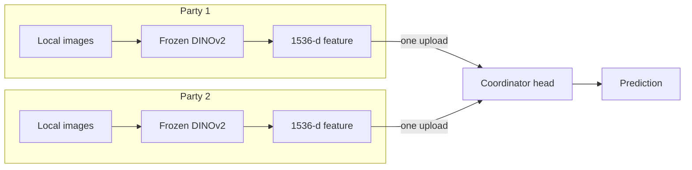
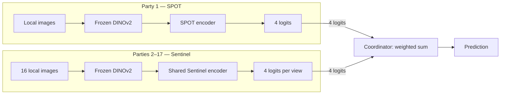

# Simple-VFL

[](https://github.com/xavierxav/Simple-VFL/actions/workflows/ci.yml)

[](LICENSE)

**Practical VFL with foundation models is easier—and highly competitive.**
Each party runs a frozen foundation model on its own images, sends a compact
feature once, and keeps the pixels. The coordinator trains a small prediction
head on the received features; its later training epochs need no further
communication with the parties. Easier in practice: the backbone is never
trained federated, the upload happens once, and only a small head is fitted.

## Result

**82.47 ± 0.70% accuracy / 95.08 ± 0.17 AUC** on VertiBench's official test set —
**+1.30 points** over the published SplitNN baseline (81.17 ± 0.35%), with a frozen
backbone, a single upload, and 3 RGB bands instead of 13. [Full tables](RESULTS.md)

## Key contributions

- **One-shot VFL with frozen foundation features.** Each party runs DINOv2
  locally, uploads one 1536-d vector per sample, and the coordinator trains a
  small head. No federated backbone training and no per-round activations.
- **A privacy/communication trade-off.** For lower-trust settings, a few-round
  variant exchanges four logits per view per round—SplitNN-like exposure with
  far smaller messages.
- **A two-sensor satellite benchmark.** WorldStrat with one SPOT party and one
  Sentinel party, IPCC labels, and a location-only audit.
- **Controlled evidence.** 82.47% on VertiBench against the published 81.17%
  SplitNN; 77.93% on IPCC against 70.66% for location alone; a capacity-matched
  control shows the multi-view gain is not head size.

## How it works



The one-shot path: each party uploads its 1536-d DINOv2 feature once, and later
head epochs stay at the coordinator. In the 16-view benchmark, each revisit is
its own party; the two-sensor benchmark adds one SPOT party. A separate
two-party variant trains local encoders and averages Sentinel vectors before
sending; that path is iterative and reported separately.

For DINOv2 ViT-g/14, one image becomes a 1536-dimensional feature (6 KiB in
float32). Sixteen Sentinel views therefore mean **96 KiB per location sent
once**, rather than repeatedly exchanging activations during head training.
That is about **100× smaller** than sending the full 12-band patches, or ~24×
smaller against an equivalent 3-band RGB input.

One could object that one-shot VFL trades privacy for convenience: a 1536-d
feature is not a raw image, but it is still a rich representation. We therefore
also evaluate a **few-round** variant: each view sends only four logits per
round. With 16 Sentinel views plus SPOT that is 68 scalars (272 B), never a full
feature. This gives SplitNN-like exposure
—no raw pixels, no complete feature vectors—while every message stays far
smaller than an activation tensor. The price is iteration: a few rounds instead
of one.

### Few-round protocol



The coordinator returns gradients for the four logits to each party.

Each party sends four numbers per round instead of a 1000-d vector or a full
feature; only logits and their gradients cross the wire.

Which protocol fits depends on the setting. With a trusted coordinator, one-shot
is simplest and cheapest. With less trust, few-round keeps raw pixels and full
features local—and in our runs it is both more accurate and faster to converge
than a classic SplitNN.

The central training loop in this repository simulates the post-upload stage;
the communication payload is calculated from tensor sizes, not measured over a
network.

To our knowledge, this one-shot, frozen-feature setup has not yet been evaluated
on an open satellite VFL benchmark.

## Why a new image-VFL benchmark?

Real datasets with vertically held images are hard to obtain. Many image-VFL
benchmarks work around this by cutting one image into patches or channel groups
and assigning the pieces to artificial parties. That is useful for testing
algorithms, but it is not a natural model of separate data owners.

**VertiBench** is the closest public satellite VFL benchmark we know: it treats
16 Sentinel revisits of the same WorldStrat locations as parties. We use it as
a reference, then build a sensor-level benchmark on WorldStrat: one party holds
high-resolution **SPOT** imagery and another holds **Sentinel-2** revisits.
Different sensors make a more natural division of views between parties.

We also use WorldStrat's **IPCC land-cover labels**, rather than relying only on
provider-name labels. The distinction matters: on `sources`, a random forest
using just longitude and latitude reaches **91.71% accuracy / 98.00 AUC**, above
the best image model. On IPCC, the same location-only baseline is **70.66 ±
0.63% / 86.49 ± 0.86 AUC**; the one-shot 16-view Sentinel model reaches
**77.93 ± 0.52% / 94.13 ± 0.53 AUC** (5 seeds). This makes the semantic task
a more informative test of what the image features add beyond geography.

## Results at a glance

| Experiment | Result | Comparison |
|---|---:|---|
| VertiBench, one-shot frozen DINOv2 + central MLP | **82.47 ± 0.70% accuracy** / 95.08 ± 0.17 AUC | Published SplitNN 81.17 ± 0.35% on 13 bands; our run uses 3 RGB bands (5 seeds) |
| WorldStrat IPCC, one-shot Sentinel features | 77.93 ± 0.52% accuracy / 94.13 ± 0.53 AUC | Location-only: 70.66 ± 0.63% / 86.49 ± 0.86 AUC (5 seeds) |
| WorldStrat IPCC, two-party SPOT + mean Sentinel | 77.42 ± 0.72% accuracy / 94.81 ± 0.21 AUC | Local encoders trained; iterative; +6.76 over location-only (5 seeds) |
| WorldStrat IPCC, SPOT + Sentinel late fusion | 78.00 ± 0.55% accuracy / **95.04 ± 0.14 AUC** | Additional iterative protocol; not the one-shot method (5 seeds) |

On the same VertiBench task and official test set, our five-seed one-shot run
reaches **82.47 ± 0.70% accuracy**, **+1.30 points** over the published
81.17 ± 0.35% SplitNN baseline, while using only three RGB bands and a frozen
foundation model.

The two-party sensor variant (SPOT encoder plus the locally averaged Sentinel
encoder output) is within 0.6 point of the late-fusion version; it trains local
encoders, so it is iterative too. A capacity-matched one-view control, with a
24.6M-parameter head instead of 1.5M, stays at 80.54% on `sources` and 72.60% on
IPCC: widening the head does not reproduce the gain of the 16 views.

The four-logit variant is cheap in epochs as well: after 10 epochs it reaches
**77.96%** on IPCC, above SplitNN's 76.50%. On validation, epoch 10 (77.94%)
already edges past SplitNN's best (77.84%, around epoch 20). SplitNN starts at
46.9% and ends lower.

## Quickstart

```bash
git clone https://github.com/xavierxav/Simple-VFL.git
cd Simple-VFL
python -m venv .venv && source .venv/bin/activate
pip install torch torchvision --index-url https://download.pytorch.org/whl/cpu
pip install -e .
cp .env.example .env  # set DATA_ROOT

simple-vfl --config-name=satellite \
    +experiment_satellite_features=sentinel
```

The smoke test needs no data:

```bash
simple-vfl --config-name=credit epochs=2 batch_size=128
```

Pre-extracted WorldStrat features and VertiBench arrays are available on
[Hugging Face](https://huggingface.co/datasets/xavvierxav/L1C_dataset) (~8.6 GB).
See the [data and setup guide](docs/TECHNICAL.md#data) before running satellite
experiments.

## In this repository

- Frozen DINOv2 feature extraction and satellite VFL experiments.
- Concatenation, late-fusion, mean-logit and shared-encoder models.
- WorldStrat location-only baseline and POI-grouped evaluation splits.
- Hydra configs, multi-seed runs, TensorBoard, tests and CI (Python 3.10–3.12).

| Read next | |
|---|---|
| [RESULTS.md](RESULTS.md) | Full tables, ablations, IPCC analysis and caveats |
| [Technical guide](docs/TECHNICAL.md) | One-shot protocol, architecture, data, configs and reproduction |
| [ATTRIBUTION.md](ATTRIBUTION.md) | Code and data attribution |

The project is research code: experiments run in a single process and the
one-time upload is represented by an analytical payload estimate, not a
network transport or a security guarantee.

## License and thanks

The original code is MIT-licensed; third-party code and data retain their own
terms. See [ATTRIBUTION.md](ATTRIBUTION.md) for details. Thanks to the VFLAIR,
WorldStrat, DINOv2, VertiBench and UCI Credit Card teams.

Xavier Desprez — [github.com/xavierxav](https://github.com/xavierxav)
