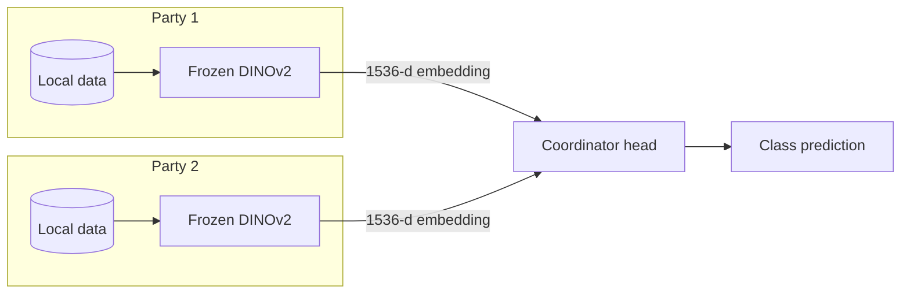

# Technical details

Everything that would otherwise bloat the [README](../README.md): architecture,
protocol vocabulary, communication budget, data layout, configuration,
reproduction, related work and limitations. Numbers live in
[RESULTS.md](../RESULTS.md).

## One-shot feature-upload protocol

The one-shot protocol is a single transfer of each party's frozen features,
not a single training epoch:

1. Each party runs the frozen DINOv2 encoder locally and computes one feature
   vector per image (or per view).
2. Each party sends its feature matrix to the coordinator once. Raw images and
   the foundation-model weights stay at the party.
3. The coordinator stores the received features and trains the prediction head
   locally. It may run many epochs over its cached feature matrix; those epochs
   do not require more communication with the parties.

The concatenation experiments (`SatelliteFeaturesCentralized` and
`SatelliteFeaturesCentralized2layers`) represent this post-upload stage: party
features are concatenated and only the central head is trained. This repository
is a single-process simulation, not a network implementation. The feature files
are read as if they had already been uploaded, and communication is estimated
analytically from tensor sizes. The `num_total_comms` counter counts training
batches; it does not measure network messages or bytes.

The late-fusion models are separate iterative baselines. Their party-side heads
are trained during optimization, so logits (and their gradients) are exchanged
per batch. Do not interpret their results or logit payload as one-shot.

## Architecture



In the raw-image SplitNN variants, the local encoders are trained end-to-end
through the global head. In the frozen-feature pipeline, the party-side encoder
is DINOv2 and stays frozen; only the coordinator head (or the per-party heads in
the aggregation variants) is trained. In the aggregation variants the global
head is removed and the party logits are averaged, or weighted, instead.

## Protocol vocabulary

- **Vertical, one-shot feature upload**: each party holds a different view of
  the same sample and sends its frozen feature once. After upload, the central
  head is trained locally; no gradient goes back to the party.
- **Horizontal proxy**: a centralized model that sees one view per POI, drawn at
  random each epoch. No clients, no FedAvg. It is a lower bound for a client
  that owns a single image per location, not a federated run.
- **Late fusion (aggregation)**: one encoder per party; the logits are averaged
  or weighted; there is no global MLP over concatenated inputs.

## Communication budget

One-time feature-upload payload per sample, float32, before protocol overhead:

| Payload | Size |
|---|---:|
| DINOv2 class token (1536 × float32) | 6 KiB |
| Sentinel L2A patch (12 × 158 × 158 × uint16) | ~0.571 MiB |
| SPOT pansharpened patch (4 × 1050 × 1050 × uint16) | ~8.4 MiB |
| 16 Sentinel views, embeddings | 96 KiB |
| 16 Sentinel views, raw patches | ~9.14 MiB |
| SPOT + 16 Sentinel, embeddings | 102 KiB |
| SPOT + 16 Sentinel, raw patches | ~17.55 MiB |

Against the full multi-channel patches, the embedding path is roughly **100×**
(16 Sentinel views) and **180×** (SPOT + 16) smaller. DINOv2 consumes a 3-band
RGB subset, so the like-for-like reduction is ~24× and ~86×. The 1.1B-parameter
backbone stays local; only the small fusion heads (about 3M parameters for the
SPOT + Sentinel model) are trained.

The 6 KiB / 102 KiB figures are one-time embedding-upload sizes. As a separate,
iterative protocol, late-fusion models send 4-d logits per batch: 256 B for 16
parties, 272 B for SPOT + 16 Sentinel on the 4-class tasks, and 448 B / 476 B on
the 7-class IPCC task. These are payload estimates, not measured network use.

## Data

Create a `.env` file at the repository root from the template:

```bash
cp .env.example .env
```

Then set `DATA_ROOT` to the folder that contains the datasets:

```text
DATA_ROOT/
├── tabledata/
│   └── UCI_Credit_Card.csv
└── satellite_dataset/
    ├── metadata.csv
    ├── lr_dataset/                 # Sentinel L2A images
    ├── hr_dataset/                 # SPOT pansharpened images
    ├── Vertibench/                 # VertiBench .npy files
    └── extracted_features_.../     # optional DINOv2 features
```

The metadata has 3,928 POIs; three are dropped before splitting, leaving 3,925
(`ASMSpotter-1-1-1` has no Sentinel features; `Landcover-1062091` and
`UNHCR-HUNs002665` were already excluded in the original normalisation
scripts), so every protocol works on the same 2,668 / 668 / 589 POIs.

`±` in the result tables is the population standard deviation across seeds
(`ddof=0`), matching `scripts/aggregate_results.py`.

Sources:

- **Credit**: [UCI Credit Card Default](https://archive.ics.uci.edu/dataset/350/default+of+credit+card+clients).
- **WorldStrat**: Sentinel L2A and SPOT images are downloaded with the notebook
  and scripts in [`worldstrat_downloading_and_features_extraction/`](../worldstrat_downloading_and_features_extraction/).
- **VertiBench**: the satellite dataset from [VertiBench](https://vertibench.xtra.science/datasets/1/).

Pre-extracted DINOv2 features and the reshaped VertiBench arrays are published on
[Hugging Face](https://huggingface.co/datasets/xavvierxav/L1C_dataset) (~8.6 GB):
`extracted_features_giant_rgb_light_preprocess.zip` (Sentinel L2A),
`extracted_features_giant_ps_normalized.7z` (SPOT) and `Vertibench.7z`. Unpack
them under `$DATA_ROOT/satellite_dataset/`, keeping the folder names used by the
configs. The VertiBench DINOv2 features are not in the archive; re-extract them
with `worldstrat_downloading_and_features_extraction/extract_features_vertibench.py`
before running `vertibench.yaml`.

The smoke test generates a synthetic credit-card CSV, so it does not need the
real dataset.

## Installation

Python 3.10 or newer is recommended (CI runs 3.10, 3.11 and 3.12).

### Option A — pip

```bash
git clone https://github.com/xavierxav/Simple-VFL.git
cd Simple-VFL

python -m venv .venv
source .venv/bin/activate

# CPU-only PyTorch (use the CUDA index instead if you have a GPU)
pip install torch torchvision --index-url https://download.pytorch.org/whl/cpu
pip install -e .
```

### Option B — conda

```bash
conda env create -f env_creation/env.yaml
conda activate VFL
pip install -e .
```

The default installation is CPU-friendly. For a CUDA build, install the PyTorch
wheel matching your driver, then run with `runtime.device=cuda` (or leave
`runtime.device=auto`, which selects CUDA when available).

## Configuration

All parameters are documented in [Parameters.md](../Parameters.md). Useful
overrides:

```bash
simple-vfl --config-name=credit runtime.device=cpu epochs=5 lr=1e-3
simple-vfl --config-name=credit model=CreditModel k=2 hidden_dim=64
```

The main configuration files are in `simple_vfl/config/`:

- `credit.yaml`: tabular credit-card experiment.
- `satellite.yaml`: satellite experiment base.
- `experiment_satellite_features/`: feature-based satellite experiments.
- `experiment_vertibench/`: VertiBench reproduction.
- `standard/`: shared runtime and Hydra settings.

## Running experiments

Satellite features:

```bash
simple-vfl \
    --config-name=satellite \
    +experiment_satellite_features=sentinel
```

Other experiments are in `simple_vfl/config/experiment_satellite_features/`
(`spot`, `spot_and_sentinel`, `vertibench`, horizontal variants, etc.). They
expect the pre-extracted DINOv2 feature folders described in
[`worldstrat_downloading_and_features_extraction/README.md`](../worldstrat_downloading_and_features_extraction/README.md).
The models use the 1536-dimensional class tokens produced by DINOv2 ViT-g/14.

Multi-run sweeps:

```bash
simple-vfl -m \
    --config-name=satellite \
    +experiment_satellite_features=sentinel \
    runtime.seed=0,1,2,3,4
```

Add `hydra/launcher=my_joblib` to run the seeds in parallel.

Aggregate several runs:

```bash
python scripts/aggregate_results.py outputs/multirun/CreditDataset
```

## Tests and CI

```bash
pip install -e ".[dev]"
ruff check simple_vfl tests scripts
pytest -q
```

The test suite includes a full one-epoch smoke test on a synthetic credit-card
dataset, plus unit tests for dataset feature handling, aggregation models, and
optional configuration handling (including a device-placement check for class
weights). GitHub Actions runs `ruff check`, `ruff format --check` and `pytest` on
every push and pull request, on Python 3.10, 3.11 and 3.12.

## Related work

Closest prior art, and why it does not already cover this benchmark:

- **Hu et al., "FL Over Images: Vertical Decompositions and Pre-Trained
  Backbones Are Difficult to Beat" (ICCV 2023, arXiv:2309.03237)** shows, in a
  *horizontal* FL setting (100 sites, disjoint image sets, identical features),
  that a frozen ResNet/DenseNet backbone plus a one-hidden-layer MLP is hard to
  beat once FLOPs and communication are counted. Its "vertical decomposition"
  splits the network across sites (IST), not the features across parties. It
  constrains the frozen-backbone claim, not the vertical data partition used
  here.
- **VFLAIR (ICLR 2024, arXiv:2310.09827)** and **VertiBench (ICLR 2024)** give
  the open VFL library and the 16-revisit satellite split used here.
  **VFLAIR-LLM (KDD 2025, doi:10.1145/3711896.3737411)** extends VFLAIR to split
  learning of LLMs, so open-source VFL + large models is not new either.
- **FeT (NeurIPS 2024, arXiv:2410.17986)** drops the exact-alignment assumption
  with fuzzy linkage, and **LASER-VFL (ICLR 2025)** handles missing parties. We
  do neither: the satellite split is aligned by construction.
- **DINOv3 (2025, arXiv:2508.10104)**, including a satellite variant pretrained
  on SAT-493M, makes frozen satellite features the standard strong baseline in
  Earth observation; DINOv2 (2023) is the backbone here.
- **Wu et al., "VFL in Practice" (2025, arXiv:2502.08160)** documents that
  several real VFL data regimes have no viable solution. Our benchmark sits in
  the aligned, complete-partition regime, not in the hard ones.

WorldStrat (NeurIPS 2022) provides the SPOT + Sentinel imagery. We do not claim
the first VFL benchmark, the first foundation-model VFL method, or the first
frozen-backbone VFL result. The claim is the combination and its measured
communication cost, dated and scope-limited in the README.

## Reproducibility manifest

- **Code**: `main` (single public commit). The 2024 VertiBench numbers predate
  this repository. The WorldStrat/IPCC runs were produced on the
  pre-publication trees (`1f1a343` for IPCC, `3cf04fc` for the weight sweep,
  `d884c29` for simplified-IPCC); the current commit contains the same training
  code plus documentation edits. A re-run on the public commit is the remaining
  verification step.
- **Splits**: 3,925 POIs after dropping `ASMSpotter-1-1-1` (no Sentinel
  features), `Landcover-1062091` and `UNHCR-HUNs002665` (already excluded in
  the original normalisation scripts); 2,668 train / 668 validation / 589 test,
  grouped by POI, identical within each label. The test boundary is fixed
  (`random_state=42`); the train/validation boundary depends on `runtime.seed`.
- **Command** (per setting, seeds 0–4):

  ```bash
  python -m simple_vfl -m \
      --config-name=satellite \
      +experiment_satellite_features=<setting> \
      runtime.device=auto runtime.num_workers=0 \
      runtime.seed=0,1,2,3,4
  ```

- **Configs** (in `simple_vfl/config/experiment_satellite_features/`):
  - `sentinel.yaml`: 16 Sentinel views, `24576 → 1000 → 4`.
  - `sentinel_aggregation.yaml`: 16 party encoders, mean logits.
  - `sentinel_horizontal.yaml`: one random Sentinel view per POI.
  - `spot.yaml`: SPOT only.
  - `spot_and_sentinel.yaml`: SPOT + 16 Sentinel, shared Sentinel encoder,
    `sentinel_weight=0.5`.
  - `spot_and_sentinel_horizontal.yaml`: one random view among the 17.
  - `spot_and_sentinel_horizontal_2views.yaml`: SPOT + one Sentinel view.
  - `spot_and_sentinel_shared_encoder.yaml`: 2024 shared-encoder variant,
    kept for provenance.
- **Data provenance**: `metadata.csv` from Zenodo record 6810792; Sentinel
  features `extracted_features_giant_rgb_light_preprocess.zip`; SPOT features
  `extracted_features_giant_ps_normalized.7z`, both from
  [Hugging Face](https://huggingface.co/datasets/xavvierxav/L1C_dataset).
- **Location baseline**: `python scripts/location_baseline.py --label <label>`
  (5 seeds for `sources`, `ipcc`, and `simplified_ipcc`).
- **Aggregation**: `python scripts/aggregate_results.py <sweep folder>`.

## Reproducibility checklist

- [x] Same POI-grouped split within each label.
- [x] Same feature archives (`light_preprocess` / `ps_normalized`).
- [x] Configs version-controlled and complete (`hidden_dim`, `sentinel_weight`).
- [x] Five-seed runs completed for the `sources`, IPCC and simplified-IPCC
  settings; IPCC and simplified-IPCC ran on a Kaggle T4.
- [x] Five-seed IPCC and simplified-IPCC runs reproduced on public commit
  `58267cb` using `scripts/kaggle/repro_ipcc5.py`; raw logs are in the local,
  git-excluded `experiments/logs/ipcc_5seed/` directory.

## Limitations

- Seeds are fixed through `runtime.seed`; the splits are grouped by POI, so no
  POI can appear in both train and test.
- The five-seed `sources` benchmark was run on CPU (local 20-core and Kaggle CPU
  runners); the five-seed IPCC and simplified-IPCC runs used a Kaggle T4
  (`xavierdesprez/simple-vfl-ipcc5`). The GPU runner copies one feature tar to
  local disk before training, so the Kaggle mount is not the bottleneck.
- The `sources` labels are provider names and are geographically clustered. A
  random forest on `lon`/`lat` alone reaches 91.71% on the same test split, so
  the WorldStrat benchmark is work in progress; see the discussion in
  [RESULTS.md](../RESULTS.md).
- The original feature-extraction scripts computed image normalisation
  statistics over the full dataset. A strict protocol would recompute them on
  the training split only.
- SPOT and Sentinel observe the same POIs, so the two-sensor result is
  multi-view fusion, not cross-silo learning on disjoint populations.
- The SPOT + Sentinel gain is small (+0.65 accuracy on `sources`, +1.80 on
  IPCC). On `sources` the paired differences are within seed noise (paired
  t-test: p ≈ 0.39 accuracy, p ≈ 0.28 AUC; the fusion loses on seed 3). The
  fusion has the best AUC among the image models on every label, but on
  `sources` the location-only baseline is higher (98.00 vs 97.33). On IPCC
  (paired t-test, n=5), the accuracy gain is +1.80 (p ≈ 0.008) and AUC gain
  +0.83 (p < 0.001); exact two-sided Wilcoxon is p = 0.0625 for both. Treat
  these small-sample tests cautiously. On simplified-IPCC the fusion-vs-SPOT
  accuracy difference is not clear (p ≈ 0.31); AUC is higher across all five
  seeds (paired t-test p < 0.001; Wilcoxon p = 0.0625). The fusion has ~3.1M
  parameters and ensembles 17 logit vectors (68 scalar logits for 4 classes) vs
  ~1.5M for SPOT-only, so part of the gain may be capacity/ensemble.
- The 16-view concat model has 24.6M parameters vs 1.5M for the 1-view model,
  so the +4.9 gain is views-plus-capacity; a capacity-matched 1-view control is
  future work.
- `sentinel_weight=0.5` was selected on seed 0's test accuracy; the seed
  standard deviation does not include model-selection variance.
- The WorldStrat table does not include an end-to-end raw-image SplitNN on the
  same split; the frozen-feature claim is supported by the preliminary
  VertiBench comparison.
- VertiBench's 16 parties are 16 revisits of the same AOI (same sensor, same
  location, different dates): multi-view fusion, not cross-silo learning over
  disjoint populations, and no entity-resolution test. No PSI or alignment step
  is performed; the split is aligned by construction.
- This is research/teaching code, not a production federated-learning system.
  It simulates parties in a single process; it does not provide secure
  aggregation, differential privacy, or communication encryption. A secure
  version would need MPC-based aggregation with output DP, as in Jin et al.
  (PoPETs 2026, arXiv:2604.13474).
